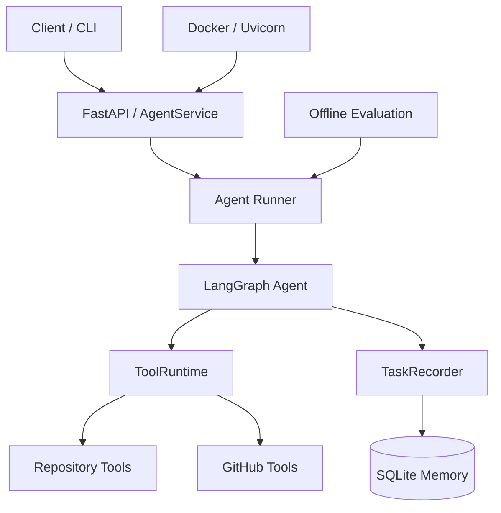
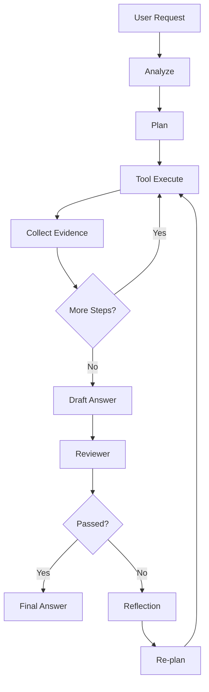

# IssueOps Agent

IssueOps Agent 是一个基于 LangGraph 的软件研发任务处理 Agent 工程型 MVP。它将任务分析、结构化规划、Repository/GitHub Tool Calling、可靠执行、Evidence、Reviewer、Reflection、Re-plan、SQLite Memory、离线 Evaluation、FastAPI 异步服务和 Docker 部署连接为一条可运行、可测试、可审查的单 Agent 链路。

当前版本为 **v0.1.0**。本项目定位为作品集级工程实现，不宣称生产就绪、无限扩展或完全自主。

- 快速入口：[本地运行](#快速开始) · [HTTP API](#fastapi-服务) · [Docker](#docker) · [Evaluation](#evaluation) · [真实 Demo](docs/demo.md)
- 深入文档：[Architecture](docs/architecture.md) · [API](docs/api.md) · [Docker](docs/docker.md) · [Evaluation](docs/evaluation.md) · [Failure Cases](docs/failure_cases.md) · [Roadmap](docs/roadmap.md)

## 项目概览

软件任务 Agent 的难点不只是生成答案，而是让分析、计划、工具执行、错误处理、证据、审查、反思和持久化形成可验证闭环。IssueOps Agent 因此把 LangGraph `AgentState` 作为运行时权威状态，把所有 Tool 统一放入有类型契约的 `ToolRuntime`，并通过独立 Benchmark、HTTP API 和 Docker 证明同一条生产链路可以被评估和部署。

它当前适合：

- 演示单 Agent 的 Plan-and-Execute、Reviewer/Reflection 与有界 Re-plan；
- 检查本地 Repository，读取公开 GitHub Issue / Pull Request；
- 研究 Tool Schema、可靠性策略、执行 Trace 和 SQLite Persistence；
- 作为 AI Agent 工程岗位的架构、测试、评测和交付样例。

## 为什么做 IssueOps Agent

许多 Agent Demo 只展示一次成功调用，无法回答失败时发生什么、结果依据是什么、能否复现、进程重启后还能否查询。该项目重点解决以下工程问题：

- Tool 输入如何由 Pydantic Schema 验证，所有执行如何统一返回 `ToolResult`；
- Retry、Timeout、Fallback 与 Re-plan 如何分层，且都有明确上限；
- 最终回答如何绑定 Evidence，并由 Reviewer 检查完成度；
- 任务、状态快照和 Trace 如何持久化，而不取代 LangGraph 权威状态；
- Agent 如何通过固定 Fixture 和结构化指标进行离线 Evaluation；
- 同一 Runner 如何通过 CLI、FastAPI 与 Docker 暴露，而不复制 Agent Pipeline。

## 核心能力

| 领域 | 已实现能力 |
| --- | --- |
| Agent | Task Analyzer、结构化 Planning、Plan-and-Execute、Draft/Final 分离 |
| Tool System | `BaseTool`、`ToolRegistry`、`ToolRuntime`、Pydantic Args Schema、`ToolResult` |
| Repository | `list_directory`、`read_file`、`search_code` 与 workspace 路径边界 |
| GitHub | 只读 Issue / Pull Request Tool、匿名或可选 Token、稳定 HTTP 错误映射 |
| Reliability | Retry、Timeout、一级 Fallback、Error Taxonomy、`MAX_TOOL_CALLS` |
| Reasoning Loop | Evidence、Reviewer、Reflection、增量 Re-plan、硬上限 |
| Memory | SQLite Task、State Snapshot、Execution Trace、重启后查询 |
| Evaluation | 20 个版本化离线用例、自动评分、JSON/Markdown 报告、失败分类 |
| Service | FastAPI、异步后台执行、任务轮询、Trace/Status/Health API |
| Deployment | `python:3.12-slim`、non-root、单 Uvicorn process、SQLite Volume |

未实现的 Multi-Agent、RAG、Vector DB、Distributed Worker 和 Kubernetes 只列入 Roadmap，不属于 v0.1.0 能力。

## Architecture



详细组件、数据所有权和部署边界见 [docs/architecture.md](docs/architecture.md)。

## Agent Workflow



三个边界分别保护不同层级：

- `MAX_RETRIES`：同一 Tool Step 的临时失败重试上限；
- `MAX_TOOL_CALLS`：单次 Agent 运行的实际 Tool attempt 总预算；
- `MAX_REFLECTIONS`：Review Fail 后 Reflection / Re-plan 上限。

## Tool System

Planner 负责选择 `tool_name` 和 `tool_args`，Executor 不从自然语言重新猜测 Tool。`ToolRuntime` 是 Validation、Timeout、Retry、Fallback 与 Error Mapping 的唯一入口；每个 Tool 都有独立 Pydantic 输入 Schema，并统一返回 `ToolResult`。

```text
PlanStep
→ ToolRuntime
→ ToolRegistry
→ Pydantic Validation
→ BaseTool.execute
→ ToolResult
```

GitHub Tool 只执行读取操作，不创建 Issue、评论、Pull Request 或提交。自动测试和 Evaluation 使用 `httpx.MockTransport`，不需要公网或真实 Token。

## Reliability

默认策略为 `max_retries=2`、`timeout_seconds=10`、`max_tool_calls=20`。`TIMEOUT`、`RATE_LIMIT` 和临时 `GITHUB_API_ERROR` 可重试；参数、认证、资源不存在等确定性错误不重试。Fallback 只允许显式映射且最多一级，Retry 耗尽会保留最后原始错误并返回稳定终态。

每次 attempt 都记录 Tool、Step、Phase、成功状态、错误码和 latency；结构化日志不输出 Tool arguments 或环境变量。

## Reviewer、Reflection 与 Re-plan

Tool 执行完成后先生成 `draft_answer`。确定性 Reviewer 检查 Goal、Evidence、关键错误、Plan 覆盖和 Draft grounding；未通过时生成结构化 Reflection，Re-plan 只追加缺失步骤并复用既有 `PlanStep` Contract。Reviewer、Reflection 和 Re-plan 都不直接执行 Tool。

当前 Reviewer 与 Planner 是规则实现，这保证了 MVP 的可重复测试，也限制了开放世界任务的泛化能力。

## Memory

`AgentState` 是唯一权威运行时状态。SQLite 位于核心闭环外围，持久化：

- `tasks`：任务状态、Final Answer 和计数；
- `state_snapshots`：节点级完整状态快照；
- `execution_traces`：Tool、Retry、Fallback、Review、Reflection 和 Final 事件。

启用或禁用 Store 不改变 LangGraph 节点语义。SQLite 数据只接受 JSON-safe 内容，并对敏感键和值进行脱敏。CLI 和 HTTP API 都可以在进程重启后查询已完成任务。

## 快速开始

环境要求：Python 3.12+、`venv` 和 `pip`。

```bash
git clone https://github.com/majingru914-cyber/issueops-agent.git
cd issueops-agent
python -m venv .venv
```

Windows PowerShell：

```powershell
.\.venv\Scripts\Activate.ps1
python -m pip install -r requirements.txt
```

macOS / Linux：

```bash
source .venv/bin/activate
python -m pip install -r requirements.txt
```

运行 CLI：

```bash
python main.py "查找项目中 AgentState 的定义"
```

输出包含 `task_id`、Plan、Tool Call/Result、Evidence、Review、Reflection 和 Final Answer。默认数据库为 `data/issueops.db`；可通过 `ISSUEOPS_DB_PATH` 或 `--database` 覆盖。

```bash
python main.py --load-task <task_id>
```

## FastAPI 服务

```bash
uvicorn api.main:app --host 127.0.0.1 --port 8000
```

| Method | Endpoint | 用途 |
| --- | --- | --- |
| `POST` | `/tasks` | 快速返回 `task_id`，后台执行 Agent |
| `GET` | `/tasks/{task_id}` | 查询状态、Final Answer 和计数 |
| `GET` | `/trace?task_id=...` | 查询持久化 Execution Trace |
| `GET` | `/status` | 查询应用任务统计 |
| `GET` | `/health` | 轻量部署健康检查 |

创建并轮询任务：

```bash
curl -X POST http://127.0.0.1:8000/tasks \
  -H "Content-Type: application/json" \
  -d "{\"query\":\"查找项目中 AgentState 的定义\"}"

curl http://127.0.0.1:8000/tasks/<task_id>
curl "http://127.0.0.1:8000/trace?task_id=<task_id>"
```

完整 HTTP Contract 见 [docs/api.md](docs/api.md)。

## Docker

构建 Release Image：

```bash
docker build -t issueops-agent:v0.1.0 .
```

使用 named volume 启动：

```bash
docker volume create issueops-data
docker run --rm --name issueops-agent \
  -p 8000:8000 \
  -v issueops-data:/app/data \
  issueops-agent:v0.1.0
```

```bash
curl http://127.0.0.1:8000/health
```

Container 默认以 non-root `issueops` 用户运行，数据库位于 `/app/data/issueops.db`。删除并重建 Container 后，只要挂载同一 Volume，已完成 Task、Final Answer 和 Trace 仍可查询。`GITHUB_TOKEN` 只能通过 runtime environment 注入，不进入 Image。详见 [docs/docker.md](docs/docker.md)。

## Evaluation

```bash
python -m eval.evaluator
```

Benchmark 包含 8 个 Repository、4 个 GitHub Mock、4 个 Reliability 和 4 个 Reflection 用例。GitHub 用例完全离线，不需要网络或 Token。

### v0.1.0 Evaluation Results

| Metric | Result |
| --- | ---: |
| Benchmark Cases | 20 |
| Passed | 19 |
| Case Pass Rate | 95% |
| Task Success Rate | 100% |
| Tool Selection Accuracy | 100% |
| Tool Argument Accuracy | 100% |
| Avg Tool Calls | 1.25 |
| Avg Execution Attempts | 1.50 |
| Retry Rate | 15% |
| Reflection Rate | 50% |
| Recovery Rate | 100% |

数字来自正式 [JSON 报告](eval/reports/evaluation-report.json) 和 [Markdown 报告](eval/reports/evaluation-report.md)。延迟是本机观测值，不作为性能 SLA。

### Failure Case

`repo-007` 被刻意保留为真实失败：Production 返回 `EXECUTION_FAILED`，Benchmark 对路径边界错误期望 `INVALID_ARGUMENT`。任务状态和 Tool 选择正确，但错误分类不一致，因此总结果保持 19/20，而不是调整数据集换取满分。详见 [docs/failure_cases.md](docs/failure_cases.md)。

## Demo

- [真实 HTTP/Docker/Evaluation Transcript](docs/demo.md)
- [Windows HTTP Client Demo](scripts/demo.ps1)

启动服务后运行：

```powershell
.\scripts\demo.ps1
```

脚本只调用现有 HTTP API，不复制 Agent 业务逻辑。

## Testing

```bash
python -m pytest -v
```

测试覆盖 Agent Graph、Tool Runtime、Reliability、Reviewer/Reflection、SQLite、Evaluation、FastAPI、Docker Contract 与 Release 文档契约。当前 v0.1.0 Release baseline 为 `156 passed`。

## 项目结构

```text
issueops-agent/
├── agent/               # LangGraph、Plan、Execute、Review、Reflection
├── tools/               # typed Tool、Registry、Runtime、Reliability
├── memory/              # SQLite Store 与 Trace Recorder
├── api/                 # FastAPI Schema、Service 与 Routes
├── eval/                # Dataset、Fixture、Scoring 与 Reports
├── tests/               # 自动化回归测试
├── docs/                # 架构、API、Demo、评测与 Release 文档
├── scripts/             # HTTP Demo Client
├── Dockerfile
├── pyproject.toml
└── README.md
```

## 设计决策

- 使用 LangGraph：显式节点、条件边和状态更新便于测试推理循环及硬上限；
- 使用确定性 Planner/Reviewer：v0.1.0 优先保证可重复、可评估，而非开放式生成能力；
- 使用统一 `ToolRuntime`：避免每个 Tool 各自实现 Validation、Retry 和错误处理；
- 使用 SQLite：满足单机 MVP 的持久化与审计需求，不引入分布式基础设施；
- Evaluation 独立于 Production Agent：Benchmark 通过公开 Runner 注入，不维护第二套 Pipeline；
- FastAPI 后台线程桥接同步 Runner：复用既有 Agent，同时明确单进程边界；
- Docker 使用单 Uvicorn process：与 SQLite sequence 和进程内 task registry 的现实边界一致。

## 已知限制

- Planner 与 Reviewer 是规则实现，复杂自然语言目标的泛化能力有限；
- Re-plan 只能补充已知类型的 Evidence 缺口，不能临时发明新 Tool；
- SQLite 和后台 task registry 只支持当前单进程模型，不支持 multi-worker 协调；
- Container 或进程在任务运行中崩溃后，不会自动续跑该任务；
- 同步 Agent 共用线程池，高并发时可能出现 saturation；
- Python 无法安全强制终止已经 timeout 的同步 Tool thread；
- 服务没有 Authentication、rate limiting 或公网部署防护；
- `GET /trace` 尚未分页，数据库也没有自动归档；
- Benchmark 只有 20 个确定性用例，GitHub 使用 Mock，不能代表开放世界或真实网络；
- 不支持 Multi-Agent、RAG、Distributed Worker、Kubernetes 或 Cloud Deployment。

## Roadmap

已实现能力与 Future Work 明确分离，见 [docs/roadmap.md](docs/roadmap.md)。v0.2 候选包括真实 LLM Planner/Reviewer、更多只读 GitHub Tool、Authentication、运行中任务恢复和扩展 Benchmark；更长期方向包括 RAG、Multi-Agent、Distributed Worker、Observability 与 Cloud Deployment。

## 文档索引

| 文档 | 内容 |
| --- | --- |
| [Architecture](docs/architecture.md) | 系统组件、Agent Workflow、状态与持久化边界 |
| [API](docs/api.md) | Endpoint、Schema、错误 Contract 与异步模型 |
| [Docker](docs/docker.md) | Build、Run、Volume、Secret 与故障排查 |
| [Evaluation](docs/evaluation.md) | Dataset、指标定义、Fixture 与局限 |
| [Failure Cases](docs/failure_cases.md) | `repo-007` 的 Expected、Actual 与 Root Cause |
| [Demo](docs/demo.md) | 真实运行命令与输出摘要 |
| [Roadmap](docs/roadmap.md) | v0.2 与长期方向 |
| [Release Notes](docs/releases/v0.1.0.md) | v0.1.0 能力、证据和限制 |
| [Release Checklist](docs/release_checklist.md) | 发布 Gate 的真实状态 |

## Development Stages

| Stage | 交付 |
| ---: | --- |
| 00 | Repository Bootstrap |
| 01 | LangGraph Loop |
| 02 | Tool Runtime 与 Repository Tools |
| 03 | GitHub Tools / HTTP |
| 04 | Plan-and-Execute 与 Evidence |
| 05 | Retry、Timeout、Fallback 与 Budget |
| 06 | Reviewer、Reflection 与 Re-plan |
| 07 | SQLite Memory 与 Trace |
| 08 | Evaluation Benchmark |
| 09 | FastAPI Async Service |
| 10 | Docker Deployment |
| 11 | v0.1.0 Release Hardening |

## License

本项目采用 [MIT License](LICENSE)。
