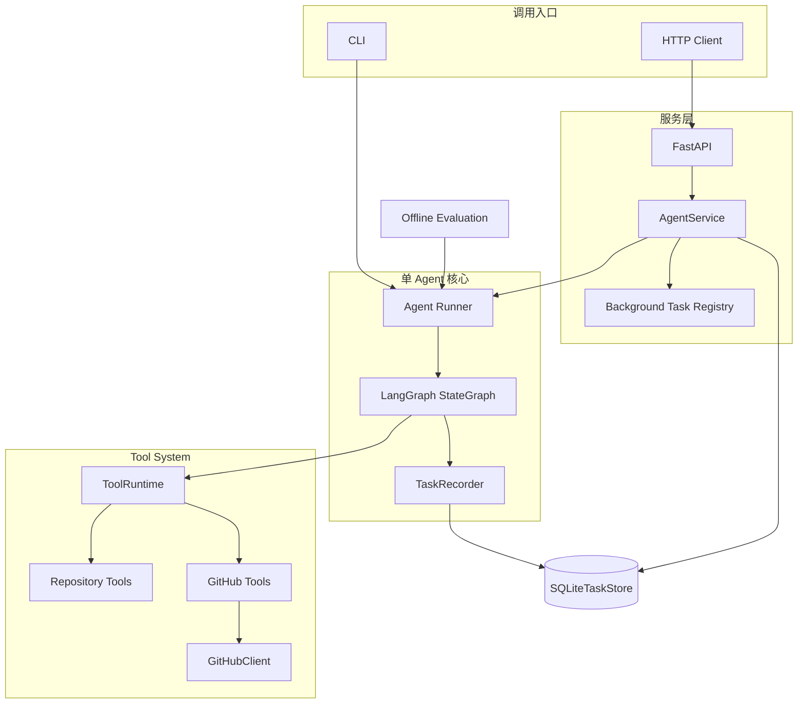
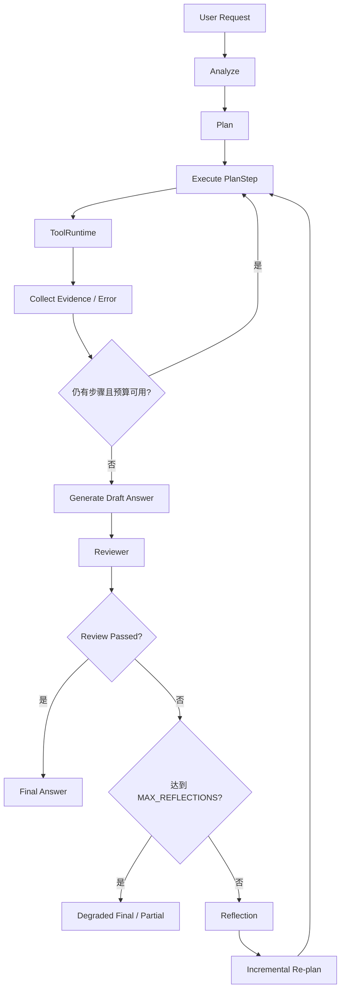
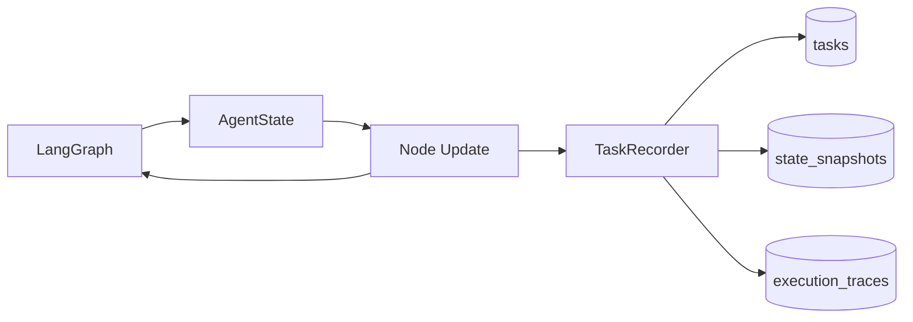
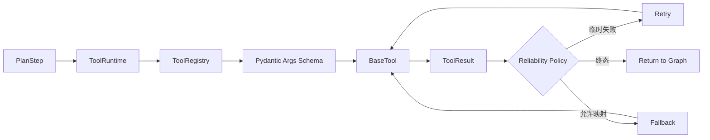

# IssueOps Agent Architecture

## 目标

IssueOps Agent v0.1.0 使用一条单 Agent Pipeline 处理软件研发任务。架构重点不是增加 Agent 数量，而是让状态、Tool、失败处理、证据、审查、持久化、评测和服务边界都可观察、可测试。

## 系统架构



Docker 只封装 `FastAPI → AgentService → Agent Runner`，不复制 Pipeline。Container 内由单个 Uvicorn process 监听 `0.0.0.0:8000`，SQLite 位于 `/app/data/issueops.db` 并通过 named volume 持久化。

## Agent Workflow



### 有界执行

| 边界 | 默认值 | 作用 |
| --- | ---: | --- |
| `MAX_RETRIES` | 2 | 同一 Tool Step 的临时失败重试上限 |
| Tool timeout | 10 秒 | 调用端等待单次 Tool attempt 的上限 |
| `MAX_TOOL_CALLS` | 20 | 单次 Agent 运行的实际 Tool attempt 预算 |
| `MAX_REFLECTIONS` | 2 | Review Fail 后 Reflection / Re-plan 上限 |

这些边界互不替代：Retry 不等于 Re-plan，Reflection 也不能绕过 Tool attempt 预算。

## State 与 Memory



`AgentState` 是当前运行的唯一权威状态。SQLite 是可重开、可查询的持久化投影，不参与 LangGraph routing 决策。任务使用同一个 `task_id` 贯穿 API、Runner、State、Snapshot 和 Trace。

持久化使用 JSON-only 序列化，不使用 pickle。敏感键和值会在进入数据库前脱敏；损坏 JSON、关闭后的 Store 调用和数据库错误都会显式失败。

## Tool System



Planner 是 Tool 选择与参数的权威来源。Executor 只执行已验证 `PlanStep`；Reviewer、Reflection 和 Re-plan 不直接调用 Tool。Repository Tool 受 workspace 相对路径边界保护；GitHub Tool 只读。

## HTTP 与异步边界

```text
POST /tasks
→ 持久化 running 任务
→ asyncio.create_task()
→ asyncio.to_thread(run_agent)
→ 立即返回 task_id
```

进程内 registry 只持有正在执行的 `asyncio.Task` 引用。任务结果和 Trace 以 SQLite 为准。已完成任务可以在服务重启后查询；运行中任务在进程崩溃后不会自动续跑。

## Evaluation 边界

Evaluation 位于 `eval/`，通过 Runner 的公开注入点运行 Production Agent。它使用版本化 Dataset、固定 Repository Fixture 和 `httpx.MockTransport` GitHub Fixture，不复制 Agent Graph，也不修改 Production Planner、Runtime 或 Reviewer。

## 关键设计决策

1. 单 Agent 优先：先闭合可靠、可评估的工作流，再考虑 Multi-Agent。
2. LangGraph State 权威：避免 SQLite 或 Service 层成为第二套运行时状态机。
3. ToolRuntime 单入口：Validation、Timeout、Retry、Fallback 和错误映射不分散到各 Tool。
4. 确定性 Planner/Reviewer：v0.1.0 优先可重复评测，真实 LLM 能力留在 Roadmap。
5. 单进程 Uvicorn：匹配 SQLite sequence、线程池和 background registry 的既有边界。

## 已知边界

- Rule-based Planner/Reviewer 对未知复杂任务能力有限；
- SQLite 不提供多进程协调；
- background registry 不提供 crash recovery；
- timeout 返回后无法强杀同步 Python thread；
- 服务无 Authentication、multi-worker、distributed queue 或公网防护；
- 当前 Benchmark 规模小且 GitHub 网络行为由 Mock 固定。
